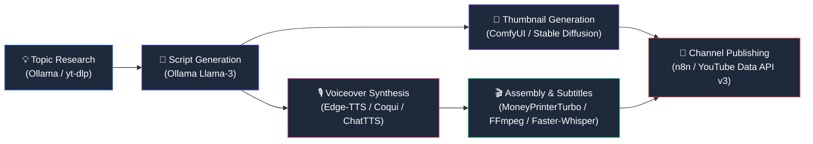

  

  
  
  
  
  
  
  

---

# 🚀 Awesome YouTube Automation

> 🎬 **A curated encyclopedia of top SaaS platforms and open-source stacks for YouTube automation, AI video generation, faceless channels, automated editing, neural voiceovers, and workflow orchestration.**

Whether you are launching an autonomous **faceless YouTube channel**, building an automated **Shorts/Reels factory**, or engineering a scalable **enterprise media pipeline**, this directory features vetted commercial products and community-proven open-source tools with transparent pricing and live metrics.

---

## 📑 Table of Contents

- [📊 Sector Overview & Market Dynamics](#-sector-overview--market-dynamics)
- [🏢 SaaS & Hosted Commercial Platforms](#-saas--hosted-commercial-platforms)
- [💻 Top Open-Source Projects & Frameworks](#-top-open-source-projects--frameworks)
- [🏗️ Recommended End-to-End Self-Hosted Architecture](#️-recommended-end-to-end-self-hosted-architecture)
- [🤝 How to Contribute](#-how-to-contribute)
- [📈 Star History](#-star-history)
- [💖 Support & Community](#-support--community)
- [⚖️ Disclaimer & Compliance](#️-disclaimer--compliance)

---

## 📊 Sector Overview & Market Dynamics

The global **AI video generation and creator automation market** is valued at approximately **$1.5 Billion in 2024** and is projected to expand to over **$10.5 Billion by 2032**, registering a compound annual growth rate (**CAGR of ~28%**). This exponential trajectory is driven by surging global consumption of algorithmic short-form video (YouTube Shorts, TikTok, Instagram Reels) combined with low-barrier generative AI tools that enable fully automated and faceless media production.

From a structural perspective, the market displays **moderate-to-high fragmentation at the consumer application layer**. Rather than converging into a winner-take-all monopoly, the sector features hundreds of agile SaaS products and micro-tools catering to distinct creative niches—such as dynamic subtitle generators, viral Reddit-to-video converters, AI thumbnail creators, and bulk uploading utilities. Conversely, the **foundational infrastructure layer remains heavily concentrated** among a handful of model providers (OpenAI, Anthropic), dedicated voice synthesizers (ElevenLabs), and cloud GPU hyperscalers. Consequently, creators increasingly combine commercial platforms with battle-tested open-source components (like n8n, FFmpeg, and Whisper) to eliminate per-render subscription fees and retain long-term workflow sovereignty.

---

## 🏢 SaaS & Hosted Commercial Platforms

The following table lists leading commercial platforms for YouTube automation, **sorted in descending order by company scale** (estimated valuation or annual recurring revenue).

| 🏢 Product | 🎯 Core Capabilities & Use Case | 💰 Estimated Scale (Valuation / Revenue) | 🏷️ Starting Paid Tier | 🎁 Free Tier / Free Trial Limits |
| :--- | :--- | :--- | :--- | :--- |
| **[Make](https://www.make.com/)** | Visual multi-app scenario orchestrator with 2,000+ connectors, data routers, webhook listeners, and automatic YouTube channel sync. | **$13.0B Parent Valuation** (~$80M ARR, Celonis division) | **$9.00/mo** (billed annually) or $10.59/mo (monthly) for Core plan (10,000 operations/mo, unlimited active scenarios) | **Free forever plan**: 1,000 operations/month, 2 active scenarios, 15-minute execution frequency, 100MB data transfer limit. |
| **[Zapier](https://zapier.com/)** | Enterprise-grade no-code automation engine connecting 7,000+ apps for triggering video uploads from cloud storage, RSS feeds, or CMS databases. | **$5.0B Valuation** (~$250M ARR) | **$19.99/mo** (billed annually) or $29.99/mo (monthly) for Starter plan (750 tasks/mo, multi-step Zaps, 3 filters) | **Free forever plan**: 100 tasks/month, 5 active single-step Zaps, 15-minute polling interval. |
| **[InVideo AI](https://invideo.io/)** | End-to-end prompt-to-video generative studio that writes scripts, generates synthetic voiceovers, compiles stock footage, and edits captions. | **$150M Valuation** (~$30M+ ARR, $52M raised) | **$20.00/mo** (billed annually) or $25.00/mo (monthly) for Plus plan (50 mins/mo AI video, 80 iStock assets, watermark removal) | **Free forever plan**: 10 mins/week AI video generation (40 mins/mo), 10GB storage, 4 exports/week with InVideo watermark (720p cap). |
| **[Submagic](https://submagic.co/)** | Specialized AI short-form video editor featuring auto-captions with emojis, automated B-roll insertion, sound effects, and viral hook templates. | **$40M Valuation** (~$12M ARR) | **$16.00/mo** (billed annually) or $20.00/mo (monthly) for Basic plan (20 videos/mo, max 90s each, 1080p 60fps export) | **Free trial**: 3 short video exports/month (max 90 seconds length each), 720p export with visible Submagic watermark. |
| **[Crayo AI](https://crayo.ai/)** | Fast-paced viral short video generator optimized for Reddit stories, fake text conversations, split-screen gameplay, and TikTok clips. | **$25M Valuation** (~$8M ARR) | **$13.00/mo** (billed annually) or $19.00/mo (monthly) for Hobby plan (250 workflow credits/mo, 2 hrs video export, 30 mins voiceover) | **No free export tier**: Free registration and project configuration only; video generation and downloads require paid plan starting at $13/mo. |
| **[TubeMagic](https://tubemagic.com/)** | AI-driven YouTube strategy and scriptwriting suite offering algorithmic video ideation, high-CTR title formulas, SEO tags, and channel audits. | **~$4M ARR** (Creator-founded) | **$41.00/mo** (billed annually at $497/yr) or $47.00/mo (monthly) for Pro plan (unlimited scripts, keyword research, SEO analyzer) | **No free trial**: Free trial paused due to spam prevention; backed by an unconditional 30-day full money-back guarantee. |
| **[ShortGenius](https://shortgenius.com/)** | Vertical AI video generator creating faceless YouTube Shorts and Reels from prompts, blog posts, and RSS feeds with auto-voiceovers and stock clips. | **~$2M ARR** | **$19.00/mo** for Lite plan (30 video exports/mo, HD 1080p, watermark removal, custom aspect ratios) | **Free forever plan**: 3 videos/month, watermark-free preview rendering, standard AI script writer and captions included (exports watermarked). |
| **[Virvid](https://virvid.ai/)** | Automated video production tool designed for faceless channels, converting topic prompts into voiceover-narrated short videos with auto-subtitles. | **~$800K ARR** | **$19.00/mo** for Starter plan (~30–40 automated video generations/mo, auto-posting queue, watermark-free) | **Free tier**: 25 initial AI credits (~2 basic short videos, watermarked, credits do not roll over). |
| **[ytZolo](https://ytzolo.com/)** | YouTube creator companion for automated high-CTR thumbnail generation, viral script outlining, keyword tags, and competitive channel benchmarking. | **~$600K ARR** | **$6.70/mo** for Standard plan (bulk thumbnail creation, SEO scoring, script templates) | **Free forever plan**: 5 AI generation credits/month for experimenting with thumbnails and script outlines. |
| **[Digital Maker AI](https://digitalmaker.ai/)** | All-in-one faceless operating system providing YouTube channel niche databases (Faceless Finder), scriptwriting tools, and multi-format video builders. | **~$500K ARR** | **$20.75/mo** (billed annually at $249/yr) for Pro plan (40 mins/mo video, 200 AI images, full niche finder database) | **Free forever plan**: 5 total video renders (1 long-form up to 8 min, 1 short up to 60s, 1 clip movie, 1 podcast) with watermark & 10 trend searches/mo. |

---

## 💻 Top Open-Source Projects & Frameworks

The following open-source tools power modern, self-hosted YouTube automation and generative video pipelines. **Sorted in descending order by GitHub Stars_Count**.

1. **[n8n](https://github.com/n8n-io/n8n)**   
   *Fair-code workflow automation engine with 400+ nodes, visual canvas, custom JavaScript/Python execution, and AI Agent integrations. The ultimate self-hosted pipeline orchestrator for triggering video rendering, cloud uploads, and YouTube Data API publishing without task fees.*

2. **[yt-dlp](https://github.com/yt-dlp/yt-dlp)**   
   *The gold-standard command-line audio/video extraction tool supporting YouTube and thousands of media sites. Crucial for automated competitor research, archival pipelines, audio extraction, and training datasets.*

3. **[AutoGPT](https://github.com/Significant-Gravitas/AutoGPT)**   
   *Autonomous AI agent framework capable of executing multi-step research plans, synthesizing trending YouTube video topics, writing narrative scripts, and invoking external editing CLI tools.*

4. **[Ollama](https://github.com/ollama/ollama)**   
   *Lightweight, blazing-fast engine to run open-weight large language models (Llama 3, Mistral, DeepSeek) locally on your GPU/CPU. Generates high-converting video scripts, YouTube descriptions, and viral hook variants privately with zero token costs.*

5. **[Stable Diffusion WebUI](https://github.com/AUTOMATIC1111/stable-diffusion-webui)**   
   *The seminal browser-based interface and REST API for Stable Diffusion models. Automates batch generation of high-CTR YouTube thumbnails, visual storyboards, and custom avatar assets.*

6. **[Open WebUI](https://github.com/open-webui/open-webui)**   
   *Extensible, feature-rich self-hosted interface for local and cloud LLMs with custom pipeline hooks, multi-user management, and retrieval-augmented generation (RAG) for deep content research.*

7. **[ComfyUI](https://github.com/Comfy-Org/ComfyUI)**   
   *Modular, node-based diffusion architecture for generative image and video pipelines. Supports SDXL, Flux, ControlNet, IP-Adapter, and AnimateDiff for programmatic thumbnail design and B-roll generation.*

8. **[MoneyPrinterTurbo](https://github.com/harry0703/MoneyPrinterTurbo)**   
   *One-click automated HD short-video generator. Input a single topic or script, and it autonomously handles LLM scripting, video material sourcing, subtitle generation, background music blending, and final export (9:16 and 16:9). Supports Docker and local/cloud LLMs.*

9. **[Whisper](https://github.com/openai/whisper)**   
   *OpenAI's robust speech recognition model trained on 680,000 hours of multilingual data. Transcribes spoken video audio with high timestamp precision for automated YouTube closed-captions and multi-language dubbing.*

10. **[FFmpeg](https://github.com/FFmpeg/FFmpeg)**   
    *The industry-standard multimedia framework for recording, transcoding, filtering, and streaming video/audio. The core rendering backbone inside almost every video automation platform and script.*

11. **[Remotion](https://github.com/remotion-dev/remotion)**   
    *Programmatic video rendering engine powered by React. Write CSS, React components, and motion graphics to render thousands of individualized YouTube videos, dynamic leaderboards, and data visualizations via CI/CD.*

12. **[Coqui TTS](https://github.com/coqui-ai/TTS)**   
    *Deep learning toolkit for advanced text-to-speech with high-fidelity voice cloning, emotional inflection, and 1,100+ pre-trained models across 110+ languages. Perfect for realistic faceless channel narration.*

13. **[ChatTTS](https://github.com/2noise/ChatTTS)**   
    *Conversational neural speech synthesis model engineered for conversational scenarios, podcasts, and video voiceovers with natural laughter, interjections, and prosody.*

14. **[Bark](https://github.com/suno-ai/bark)**   
    *Transformer-based audio model capable of generating expressive speech, background noise, music, and sound effects from text prompts.*

15. **[Diffusers](https://github.com/huggingface/diffusers)**   
    *Hugging Face's modular library for state-of-the-art pretrained diffusion models, providing Python APIs for programmatic text-to-image and text-to-video synthesis pipelines.*

16. **[MoneyPrinterV2](https://github.com/FujiwaraChoki/MoneyPrinterV2)**   
    *Complete automation engine for YouTube Shorts and online media, featuring modular tasks, automated CRON scheduling, speech synthesis, and video stitching.*

17. **[Open-Sora](https://github.com/hpcaitech/Open-Sora)**   
    *Open-source democratization of high-quality diffusion transformer video generation. Generates photorealistic AI video clips for dynamic B-roll and visual storytelling.*

18. **[Faster-Whisper](https://github.com/SYSTRAN/faster-whisper)**   
    *Reimplementation of OpenAI's Whisper model using CTranslate2, delivering up to 4x speedups and reduced VRAM consumption for ultra-fast automated subtitle generation.*

19. **[Activepieces](https://github.com/activepieces/activepieces)**   
    *Open-source, no-code workflow automation engine with 600+ integrations and AI agent builders. An MIT-licensed self-hosted alternative to Zapier for orchestrating YouTube publishing queues.*

20. **[PyVideoTrans](https://github.com/jianchang512/pyvideotrans)**   
    *Open-source video translation and dubbing tool that transcribes existing videos, translates text to any language, synthesizes new localized voiceovers, and generates synchronized bilingual subtitles.*

21. **[VideoLingo](https://github.com/Huanshere/VideoLingo)**   
    *All-in-one Netflix-grade video subtitle localization, translation, and automated dubbing system. Uses NLP segmenting, Whisper transcription, and personalized voice matching for global YouTube reach.*

22. **[MoviePy](https://github.com/Zulko/moviepy)**   
    *Python library for programmatic video editing, cut transitions, title overlays, audio track compositing, and automated custom video generation.*

23. **[Instaloader](https://github.com/instaloader/instaloader)**   
    *Python tool to download public pictures, Reels, and metadata from Instagram for cross-platform content repurposing and trend analysis.*

24. **[Pytube](https://github.com/pytube/pytube)**   
    *Lightweight, dependency-free Python library for downloading YouTube videos, fetching stream metadata, and parsing playlist URLs.*

25. **[CogVideo](https://github.com/zai-org/CogVideo)**   
    *State-of-the-art open-source text-to-video generative model (CogVideoX) producing fluid, coherent video sequences for AI-generated B-roll.*

26. **[AnimateDiff](https://github.com/guoyww/AnimateDiff)**   
    *Animation framework that inserts motion modeling modules into existing text-to-image diffusion models to generate stylized animated shorts.*

27. **[Edge-TTS](https://github.com/rany2/edge-tts)**   
    *Python module to communicate with Microsoft Edge's online text-to-speech service without an API key or Azure subscription, offering zero-cost, high-clarity neural voiceovers.*

28. **[Piper](https://github.com/rhasspy/piper)**   
    *Fast, local neural text-to-speech engine running with low latency on low-resource machines and Raspberry Pis, ideal for lightweight batch narration.*

29. **[Google APIs Python Client](https://github.com/googleapis/google-api-python-client)**   
    *Official Google client library providing programmatic access to the YouTube Data API v3 for uploading videos, managing playlists, and retrieving channel analytics.*

30. **[ShortGPT](https://github.com/RayVentura/ShortGPT)**   
    *Experimental automation framework for short-form content creation, handling voiceover generation, media asset scraping, automated captioning, and multi-language exports.*

31. **[MoneyPrinterPlus](https://github.com/ddean2009/MoneyPrinterPlus)**   
    *Enhanced multi-threaded video generation pipeline offering customizable video prompts, batch generation modes, and rich subtitle formatting.*

32. **[Auto-Editor](https://github.com/WyattBlue/auto-editor)**   
    *Command-line tool that automatically edits videos by analyzing audio decibel levels to trim out silent pauses, dead air, and filler sections without human intervention.*

33. **[OpenTimelineIO](https://github.com/AcademySoftwareFoundation/OpenTimelineIO)**   
    *Pixar-originated open interchange format and API for editorial timeline data, enabling scripted automation between Python scripts and professional NLEs (Premiere, DaVinci Resolve).*

34. **[YouTubeUploader](https://github.com/porjo/youtubeuploader)**   
    *Headless command-line tool written in Go to automatically upload video files to YouTube with metadata tags, playlists, and OAuth2 token handling.*

---

## 🏗️ Recommended End-to-End Self-Hosted Architecture

To build a **zero-subscription, 100% owned YouTube Automation pipeline**, you can connect these modular open-source layers:

- **Workflow Orchestration**: Run **[n8n](https://github.com/n8n-io/n8n)** on Docker to schedule jobs, monitor webhooks, and coordinate the entire lifecycle.
- **Content Ideation & Scripting**: Use **[Ollama](https://github.com/ollama/ollama)** locally to brainstorm viral hooks and draft structured scripts.
- **Voiceover Generation**: Synthesize narration with **[Edge-TTS](https://github.com/rany2/edge-tts)** (free neural voice) or **[ChatTTS](https://github.com/2noise/ChatTTS)**.
- **Media Assembly & Timing**: Pass assets to **[MoneyPrinterTurbo](https://github.com/harry0703/MoneyPrinterTurbo)**, **[MoviePy](https://github.com/Zulko/moviepy)**, or **[FFmpeg](https://github.com/FFmpeg/FFmpeg)**.
- **Captions & Translations**: Auto-transcribe and format dynamic subtitles using **[Faster-Whisper](https://github.com/SYSTRAN/faster-whisper)** and **[VideoLingo](https://github.com/Huanshere/VideoLingo)**.
- **Automated Publishing**: Schedule and upload using **[Google APIs Python Client](https://github.com/googleapis/google-api-python-client)** or **[YouTubeUploader](https://github.com/porjo/youtubeuploader)**.

---

## 🤝 How to Contribute

Contributions from developers and creators are welcome! To propose a new SaaS product or open-source repo:

1. **Fork** this repository.
2. Check existing entries to prevent duplicates.
3. Follow the established formatting conventions:
   - For **SaaS**: Include accurate starting tier pricing, specific free tier/trial limits, and company scale.
   - For **Open-Source**: Include the social-style Stars_Badge linked to stargazers and place in the correct star-count sorted position.
4. Open a **Pull Request** with a concise summary of the addition.

---

## 📈 Star History

---

## 💖 Support & Community

Thank you for exploring **Awesome YouTube Automation**! If you find this curated directory valuable for scaling your channels, automating video workflows, or building creator AI tooling:

- ⭐ **Star this repository** to boost visibility and support ongoing curation.
- 🍴 **Fork the repo** to keep a reference copy and build your own extensions.
- 📢 **Share with creators** on Twitter/X, LinkedIn, Discord, and Reddit.
- ☕ **Sponsor the Project:** If this compilation saves you time or empowers your business, consider supporting ongoing research and maintenance via the [GitHub Sponsor Dashboard](https://github.com/sponsors/ishandutta2007).

---

## ⚖️ Disclaimer & Compliance

- This repository is a **community-curated directory** intended for educational, research, and developer productivity purposes.
- Users are solely responsible for ensuring that all automated workflows comply with the [YouTube Terms of Service](https://www.youtube.com/t/terms), YouTube Community Guidelines, Developer API Quotas, and applicable copyright laws.
- Mass generation of spam or misleading automated content violates platform policies and may result in channel termination.
